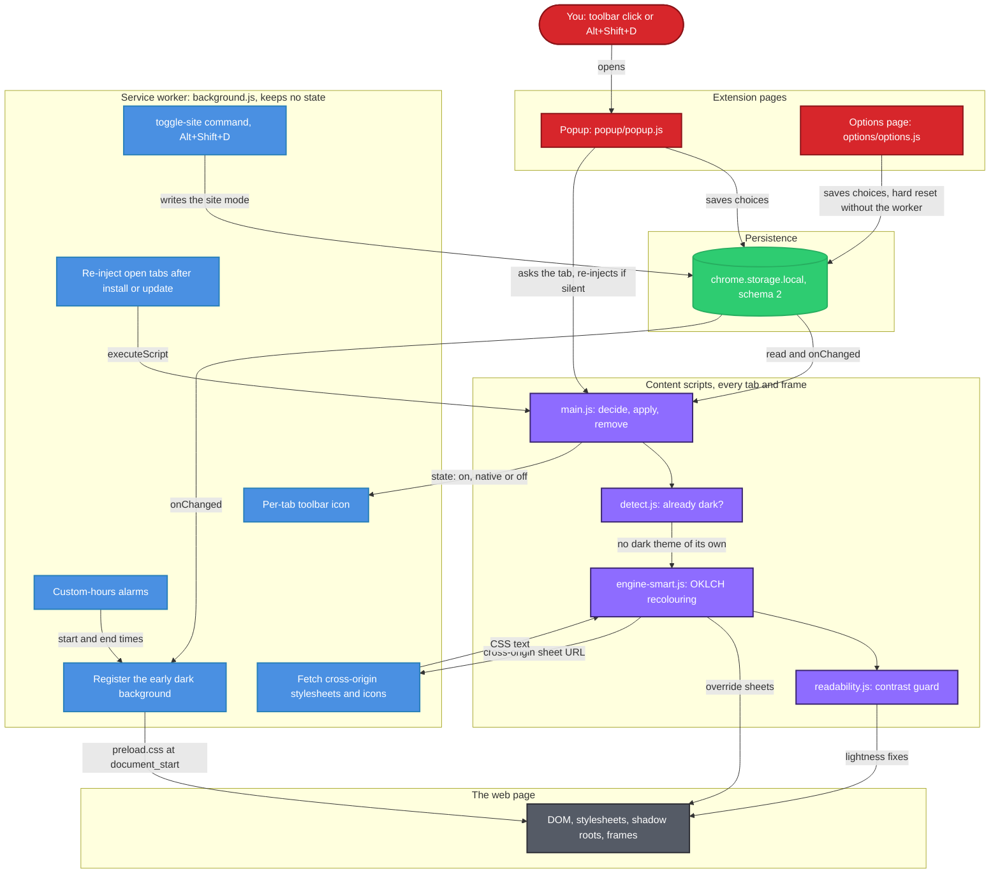
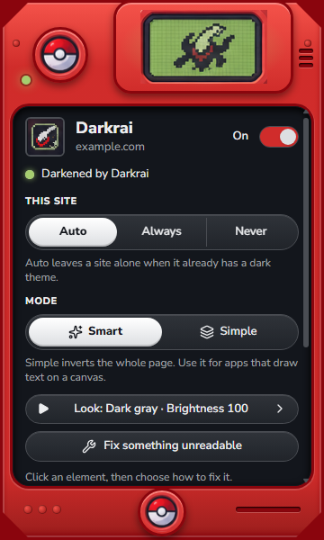
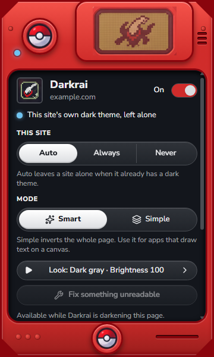
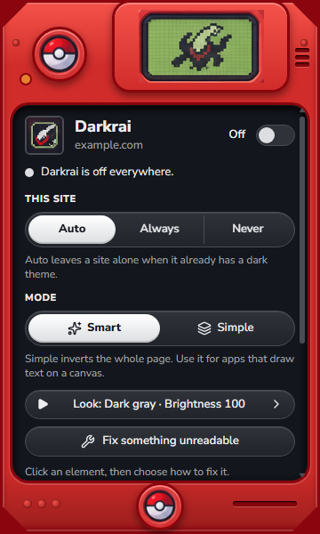
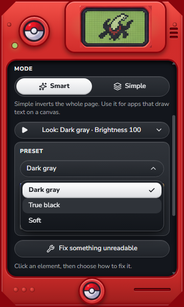
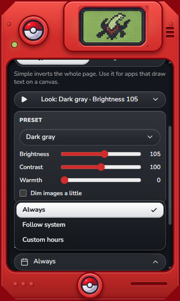
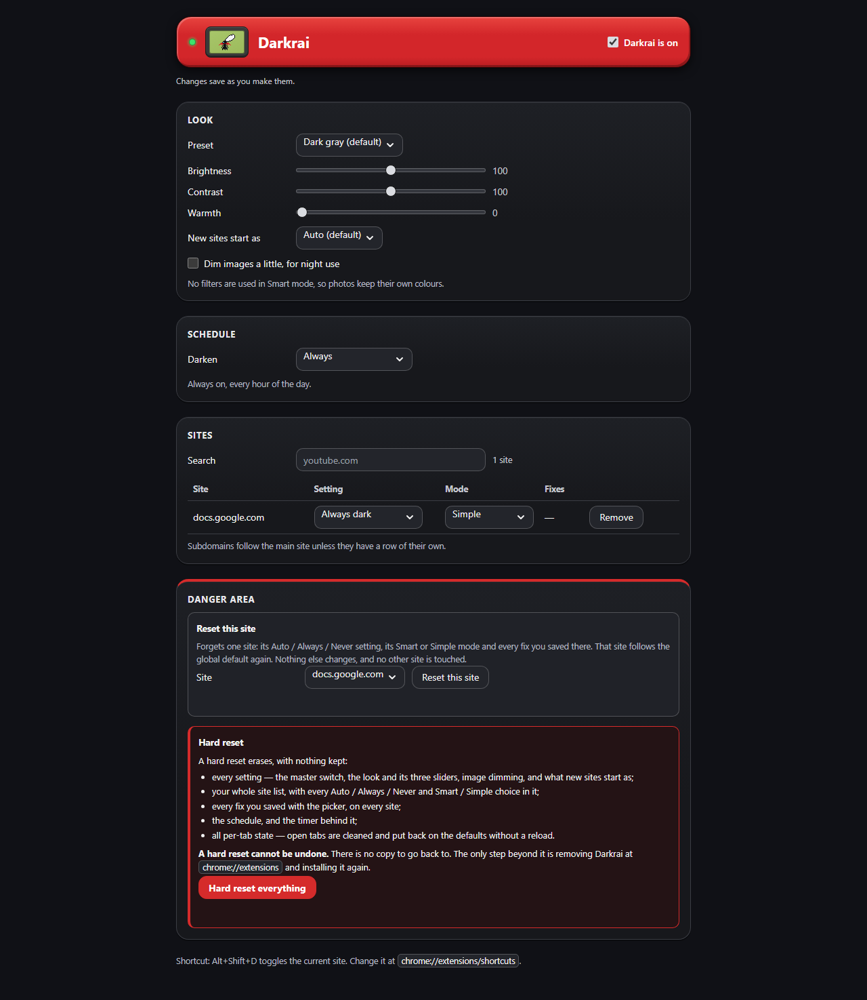
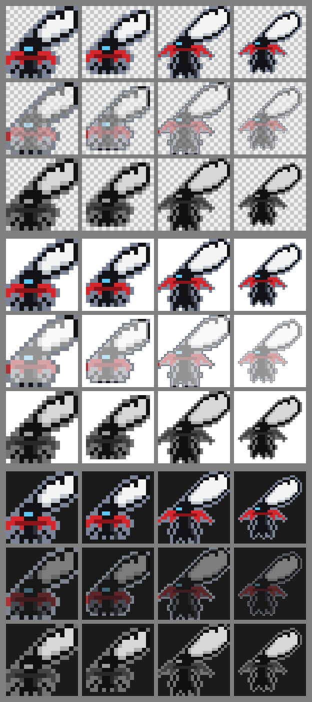

# 🌑 Darkrai: Smart Dark Mode for Chrome

[](extension/manifest.json)
[](extension/manifest.json)
[](docs/VERIFICATION.md)
[](extension/manifest.json)
[](tests/package.json)
[](docs/VERIFICATION.md)
[](extension/content/readability.js)

A Manifest V3 Chrome extension that **darkens the sites that have no dark theme of their own and leaves the ones that do alone**. Every site starts on Auto: Darkrai reads the page's declared colour scheme and samples the colours actually on screen, so YouTube in its dark theme, or MDN after it switches its own theme, keeps its own design. When Darkrai does darken a page, its default Smart mode **recolours every colour by its role in OKLCH instead of inverting**, so hue survives and photos, video and canvas are never touched. Then it **measures the contrast of the visible text and icons** and nudges anything that falls short of WCAG. Plain JavaScript, no build step, no dependencies, no analytics.

> 📖 **Full guide:** [docs/GUIDE.md](docs/GUIDE.md): installing, every control, the resets, the manual checklist, the test suites and the measured performance.
>
> 🧾 **Release evidence:** [docs/VERIFICATION.md](docs/VERIFICATION.md): every suite and real-Chrome run behind the numbers on this page, misses included.

---

## ⚡ Recruiter Fast-Track (30-Second Summary)

If you are a recruiter, hiring manager or SDE interviewer checking the technical depth of this repository, these are the four things to look at first:

*   **Native Dark-Theme Detection**: Before touching a page, Darkrai reads its declared `color-scheme` and samples the real background on a 3 × 3 grid with `elementsFromPoint`, plus the colour of the visible text. When at least 6 of 9 samples are dark (OKLCH L < 0.45) and the text is lighter, the site already has a dark theme and Darkrai leaves it alone. A watcher re-measures when the site flips its own theme, so no reload is needed. In real Chrome, YouTube's dark theme ended with 0 Darkrai style nodes and 0 adopted sheets.
*   **Role-Based OKLCH Recolouring**: Every colour declaration is mapped by role (background, text, border) in OKLCH, so hue and alpha survive and out-of-gamut results lose chroma rather than hue. CSS custom properties get per-role variants (`--dr-bg--x`), `var()` is followed into shorthands and fallbacks, and open shadow roots and `adoptedStyleSheets` get their own overrides. Stylesheets from other origins are fetched by the worker and parsed with `CSSStyleSheet.replaceSync`.
*   **Reliability Against the MV3 Lifecycle**: The popup reads `chrome.storage.local` itself and never waits on the service worker. Every `chrome.*` call has a timeout and a fallback, a tab that does not answer is re-injected on the spot, and any older copy of the page script removes itself. The hard reset runs from the page that owns the button, without the worker, in seven independent steps with their own timeouts.
*   **Tested Up to a Real Browser**: 171 unit tests on Node's built-in runner, 13 self-checking fixture pages, 11 headless UI check families (contrast read from screen pixels, focus rings, a 27-action behaviour replay against a recorded baseline), and a real-Chrome harness that loads the unpacked extension over `--remote-debugging-pipe` with CDP `Extensions.loadUnpacked`, then checks YouTube, Wikipedia, MDN, BBC News and more. Passes and misses are published side by side.

---

## 📂 Direct Code Navigation (Key Implementation Anchors)

Skip the folder tree and go straight to the code behind each feature:

| Feature | Key Logic File | Role / Purpose |
| :--- | :--- | :--- |
| **🔍 Dark-Theme Detection** | [`extension/content/detect.js`](extension/content/detect.js) | The pure `decide()` over nine screen samples, and `createWatcher()`, which re-measures when a site switches its own theme. |
| **🎨 OKLCH Colour Maths** | [`extension/shared/color.js`](extension/shared/color.js) | Colour parsing, `roleForProperty()`, `transformOklch()`, gamut mapping, WCAG contrast and `fixForContrast()`. Dependency-free and shared by the page, the worker, the popup and Node. |
| **🧩 Recolouring Engine** | [`extension/content/engine-smart.js`](extension/content/engine-smart.js) | An override sheet per page stylesheet, `var()` role variants, lost longhands, inline styles, open shadow roots and adopted sheets, all inside `@media screen`. |
| **👁️ Readability Guard** | [`extension/content/readability.js`](extension/content/readability.js) | Measures visible text and icons against the stack actually behind them, in 8 ms slices, and nudges lightness until 4.5:1 (3:1 for large text and icons) is met. |
| **🔄 Page Lifecycle** | [`extension/content/main.js`](extension/content/main.js) | Decides, applies and removes live, coalesces bursts of setting changes (80 ms settle, 2 s cap) and takes down older copies of itself. |
| **⚙️ Service Worker** | [`extension/background.js`](extension/background.js) | Keeps no state: re-injection, the Alt+Shift+D command, the early dark background, schedule alarms, the per-tab icon and cross-origin fetches. |
| **🪟 Storage-First Popup** | [`extension/popup/popup.js`](extension/popup/popup.js) | Reads settings straight from storage, puts a timeout on every `chrome.*` call and re-injects a tab that does not answer. |
| **🧯 Hard Reset** | [`extension/shared/reset.js`](extension/shared/reset.js) | Seven independent, individually timed steps that call `chrome.*` directly, never through the worker, with an itemised result. |
| **🗃️ Storage Schema** | [`extension/shared/settings.js`](extension/shared/settings.js) | Schema 2 defaults, an `upgrade()` that never throws, subdomain matching and the schedule maths. |
| **🧪 Real-Chrome Harness** | [`tests/real-chrome/run-real-chrome.js`](tests/real-chrome/run-real-chrome.js) | Installed Chrome on a throwaway profile, CDP over `--remote-debugging-pipe`, `Extensions.loadUnpacked` and real public sites. |

---

## 📌 Problem Statement

Dark-mode extensions promise one switch for the whole web. Darkrai started from three frustrations with the ones already out there:

1. **The icon stopped responding**: clicking the pinned, enabled icon sometimes did nothing. A popup that waits on a background worker Chrome has put to sleep stays blank, and after an update, open tabs keep a disconnected copy of the old page script.
2. **Dark mode everywhere, wanted or not**: it forced its own dark mode on every tab and overrode sites that already had one, such as YouTube.
3. **A look that didn't fit the site**: icons and text became invisible or unreadable. Logos and photos got inverted, dark text landed on dark backgrounds, colours hidden in CSS variables, inline styles and shadow DOM were never reached, and nothing checked the result.

**Darkrai** answers each one directly:

1. **A popup that never waits**: plain HTML and JavaScript that reads `chrome.storage.local` itself, puts a short timeout on every `chrome.*` call and re-injects the page script into a tab that does not answer. On pages Chrome blocks (`chrome://` pages, the Web Store, the PDF viewer) it explains why instead of failing silently.
2. **Auto by default**: every page is checked first, and a site with its own dark theme is left alone. A per-site Auto / Always / Never choice, inherited by subdomains, covers the rest.
3. **Recolour by role, then measure**: backgrounds go dark, text goes light and borders sit between, with hue kept so a site still looks like itself. Then the readability guard measures every visible text run and icon and fixes the ones below WCAG. The picker and a per-site Simple mode are the backstops.

It also covers the usual complaints about dark-mode extensions:

*   **White flash while loading**: a small dark background, `extension/preload.css`, is registered to run at `document_start` while Darkrai is on and the schedule allows it, and never for a site set to Never.
*   **Inverted photos**: Smart mode never inverts images, video or canvas. Only small dark icons on transparent backgrounds are inverted, one at a time.
*   **Needing a reload**: switching on or off, changing a site's mode and changing the look all apply live, through `chrome.storage.onChanged`.
*   **Printing**: every stylesheet Darkrai generates is wrapped in `@media screen`, so none of it applies when the page is printed.

---

## ✨ Key Features

### 🔍 Smart Detection
*   **Auto by Default**: Darkrai reads `<meta name="color-scheme">` and the computed root `color-scheme`, samples nine points on screen and compares the text colour with what is behind it.
*   **Live Re-Checks**: theme attributes on `<html>` and `<body>`, `<meta>` changes, `prefers-color-scheme` and in-app navigation re-run the decision, throttled to once per 500 ms. An unclear result is measured again 1.5 s later.
*   **No Flicker While Measuring**: when Darkrai is already active, it disables its own sheets, reads the page's colours and re-enables them in one synchronous task, so nothing paints in between.
*   **Per-Site Choice**: Auto, Always or Never per site. `music.youtube.com` follows `youtube.com` unless it has an entry of its own.

### 🎨 The Recolouring Engine
*   **Role Mapping in OKLCH**: backgrounds, text and borders each follow their own lightness curve with hue kept, so a red button stays red.
*   **Everywhere Colours Hide**: every stylesheet (recursing into `@media`, `@supports`, `@layer`, `@container` and `@import`), cross-origin sheets, CSS variables, `var()` inside shorthands and fallbacks, inline styles, SVG `fill` and `stroke`, legacy `bgcolor`, open shadow roots, constructed sheets and every frame.
*   **Mask-Painted Icons**: in a rule that also sets a CSS mask, `background-color` is the icon's glyph (the way Wikimedia Codex draws icons), so it takes the text role and turns light.
*   **Media Stays Untouched**: photos, video and canvas are never inverted. Icon rescue samples small images at 32 × 32 and inverts only dark, nearly colourless icons on transparent backgrounds.
*   **Simple Mode**: a whole-page `invert(0.9) hue-rotate(180deg)` with media re-inverted, for apps that draw their text on a canvas. Google Docs, Sheets and Slides (`docs.google.com`) are preset to it.

### 👁️ Readability Guard & Picker
*   **Measured on Screen**: visible text, form controls, single-colour SVG icons, icon-font glyphs and CSS-mask icons are measured against the composited stack behind them, visible area first.
*   **WCAG Targets**: 4.5:1 for normal text, 3:1 for large text and icons. Anything below gets a binary-searched lightness with its hue kept, and only that element changes.
*   **Budgeted Work**: up to 300 elements per idle slice of 8 ms, stopping when less than 2 ms is left.
*   **Fix Something Unreadable**: point at an element with the mouse or the keyboard, choose **Make readable** or **Invert this**, and the fix is saved for that site.

### 🎮 The Pokédex Popup
*   **A Plain-CSS Port of a Lovable Design**: a 360 × 600 red Pokédex casing with screws and vents, a raised LCD showing Darkrai, two Poké Ball modules and a status LED. Only the dark screen scrolls; the casing never does.
*   **State Shown Three Ways**: a green LED for darkening, ice-blue with the LCD art at 60 % for a site's own dark theme and amber when off, each with a matching status sentence, so colour is never the only signal.
*   **Themed Dropdowns**: Chrome's customizable select (`appearance: base-select`, Chrome 135 and later) draws the open lists in the screen's style and opens them above the pill when there is no room below. Older Chrome keeps its default list.
*   **Presentation Only**: the redesign kept the popup's behaviour. A replay of 27 popup actions still makes the same 92 `chrome.*` calls and 20 storage writes as the recorded baseline.

### 🌙 Looks & Schedule
*   **Three Looks**: Dark gray (default), True black and Soft, with brightness, contrast and warmth sliders that feed the colour maths directly. Smart mode uses no CSS filters; the optional "Dim images a little" is the one exception.
*   **Schedule**: Always, Follow system (dark only while Chrome or the OS is dark), or Custom hours such as 19:00 to 07:00, handled across midnight by a `chrome.alarms` timer.

### 🧯 Resets
*   **Reset This Site**: forgets one stored entry (its mode, engine and fixes) after one inline confirmation, and leaves every other site byte-identical.
*   **Hard Reset Everything**: a two-step in-page dialog with Cancel as the default and focus kept inside. It erases every setting, the site list, every fix, the schedule and its alarm, and cleans open tabs without a reload.
*   **Honest Results**: seven independent steps, each with its own timeout. A step that failed or timed out is reported as such, with the reason, never as success.

### 🔒 Privacy
*   **No Analytics, No Remote Code**: settings never leave `chrome.storage.local`, and nothing about you is sent anywhere.
*   **The Only Network Requests**: stylesheets and icon images the page itself already uses, fetched by the worker without cookies, http(s) only, with a 5 MB cap and a 10 s timeout. For an icon, the worker answers only yes or no.
*   **Three Permissions**: `storage`, `scripting` and `alarms`, plus access to http and https pages, which any extension that restyles pages needs. No `tabs`, history, downloads or cookies permission.

### ♿ Accessibility
*   **Reduced Motion**: with `prefers-reduced-motion: reduce`, transitions become instant and the end state is the same.
*   **Forced Colours**: under `forced-colors: active`, the casing gives way to system `Canvas` and `CanvasText` surfaces with real borders.
*   **More Contrast**: `prefers-contrast: more` switches to high-contrast tokens.
*   **Keyboard and Focus**: every control works from the keyboard with a visible focus ring (UI check family (d)), the picker works with Tab and Enter and Esc cancels it, and only `transform` and `opacity` ever animate (family (c)).

The automated checks cover contrast, focus rings and layout shifts. Full WCAG conformance also needs manual testing with assistive technology and an expert review.

---

## 🏗️ System Architecture

Darkrai is built around one store. The popup and the Options page write `chrome.storage.local`, the page script in every tab and frame reads it and listens for changes, and a service worker that keeps no state does the jobs only a worker can do:



---

## 💻 Tech Stack

| Technology | Category | Usage / Context |
| :--- | :--- | :--- |
| **Chrome Extensions, Manifest V3** | Platform | `chrome.storage` (the single store), `chrome.scripting` (re-injection and `registerContentScripts`), `chrome.alarms` (custom hours), `chrome.commands` (Alt+Shift+D), `chrome.action` (per-tab icon and title) |
| **JavaScript (vanilla)** | Language | No build step and no bundler. Content scripts are wrapped IIFEs on one `window.Darkrai` namespace, since MV3 content scripts cannot be ES modules; shared modules are UMD, so the page, the worker, the popup and Node load the same file |
| **CSS** | Styling | Custom properties for the Pokédex tokens, the customizable select (`appearance: base-select`, `::picker(select)`) placed with anchor positioning (`position-area`, `position-try-fallbacks`), and `@media screen` around every generated sheet |
| **OKLCH colour maths** | Colour engine | Hand-written sRGB ↔ OKLab ↔ OKLCH conversion, role transforms, gamut mapping by chroma reduction, WCAG luminance and contrast, LRU caches |
| **Lucide (lucide-static 0.575.0)** | Icons | The popup's line icons, inlined as one SVG sprite in `popup.html`; ISC License |
| **Nunito Sans** | Typeface | Bundled variable latin subset, `nunito-sans-latin.woff2`; SIL Open Font License 1.1 |
| **Node.js built-in test runner** | Unit tests | `node:test` and `node:assert`, 171 tests, no packages; run on Node v24.12.0 |
| **chrome-headless-shell + CDP** | Browser tests | Fixtures, UI checks and performance runs over the DevTools protocol with Node's built-in WebSocket client; uses a shell already on the machine and never downloads one |
| **Google Chrome over `--remote-debugging-pipe`** | End-to-end tests | Installed Chrome 157 on a throwaway profile, with the extension loaded by `Extensions.loadUnpacked` |

---

## 🗃️ Storage Design

Everything Darkrai remembers is one versioned object in `chrome.storage.local`, shown here with its defaults. `upgrade()` in `extension/shared/settings.js` accepts anything (missing, partial, from an older build or corrupted) and returns a complete schema-2 store without throwing.

```
                         ┌──────────────────────────────────┐
                         │ chrome.storage.local  (schema 2) │
                         └────────────────┬─────────────────┘
      ┌──────────────────┬────────────────┴─────────┬──────────────────────┐
      │                  │                          │                      │
┌─────▼─────┐  ┌─────────▼─────────┐   ┌────────────▼────────────┐  ┌──────▼───────┐
│ schema: 2 │  │ settings          │   │ sites                   │  │ debug: false │
└───────────┘  │ enabled: true     │   │ { host: entry }         │  │ dev timing   │
               │ defaultMode: auto │   └────────────┬────────────┘  └──────────────┘
               │ look: gray        │                │ (N hosts)
               │ brightness: 100   │   ┌────────────▼────────────┐
               │ contrast: 100     │   │ mode: auto | on | off   │
               │ warmth: 0         │   │ engine?: smart | filter │
               │ dimImages: false  │   │ fixes[]?: up to 200     │
               │ schedule          │   └────────────┬────────────┘
               └─────────┬─────────┘                │ (N)
               ┌─────────▼─────────┐   ┌────────────▼────────────┐
               │ type: always      │   │ selector: CSS selector  │
               │ from: 19:00       │   │ action: readable|invert │
               │ to: 07:00         │   └─────────────────────────┘
               └───────────────────┘
```

### Key Fields Explained:
*   **schema**: the store format, now 2. Schema 2 added `debug`; older stores, including the pre-schema `siteList` shape, are upgraded in place.
*   **settings**: the master switch (`enabled`), what new sites start as (`defaultMode`: `auto`, `on` for Always, `off` for Never), the look (`gray`, `black` or `soft`), brightness and contrast (clamped to 50-150), warmth (0-100), `dimImages`, and the schedule (`always`, `system` or `hours`, with `from` and `to`).
*   **sites**: one entry per registrable domain or host. A subdomain follows its parent's entry unless it has its own, and public suffixes such as `co.uk` are never matched. `mode` is always present; `engine` (`filter` is Simple mode) and `fixes` are optional. The default store ships one entry: `docs.google.com` as `{ mode: "on", engine: "filter" }`.
*   **fixes**: what the picker saved, up to 200 per site, each a CSS selector and an action (`readable` or `invert`). A newer fix for the same selector replaces the older one.
*   **debug**: dev-only timing marks, off for everybody. `chrome.storage.local.set({ debug: true })` from Darkrai's own DevTools console turns them on.

---

## 🔄 How a Page Is Decided

The page script runs at `document_start` in every frame and makes one decision per page, in `decideForPage()` (`extension/shared/settings.js`) and `runDecision()` (`extension/content/main.js`):

```
 [page script starts: document_start, every frame]
                     │
                     ▼
            settings.enabled? ───── no ─────► skip
                     │ yes
                     ▼
          inside the schedule? ──── no ─────► skip
                     │ yes
                     ▼
    site mode: own entry → parent domain → defaultMode
                     │
     ┌───────────────┼──────────────────┐
     │ Never         │ Always           │ Auto
     ▼               ▼                  ▼
   skip           darken        detect.measure()
                          declared color-scheme, 3×3 samples, text
                                        │
                              ┌─────────┴───────────┐
                              ▼                     ▼
                        already dark          no dark theme
                    native: left alone,       darken: engine,
                    0 style nodes,            readability guard,
                    ghosted icon              colour icon
                              │                     │
                              └─────────┬───────────┘
                                        ▼
                      watcher: <html>/<body> attributes, <meta>,
                      prefers-color-scheme, in-app navigation
                      → measure again, throttled to 500 ms
```

### Decision Details:
1.  **Settings First**: if Darkrai is off, the schedule says not now, or the site is set to Never, the page is skipped. Anything Darkrai applied is removed, `<html data-darkrai="off">` is set and the toolbar icon goes grey.
2.  **Always Darkens Without Measuring**: only Auto measures first, with `detect.measure()`.
3.  **Already Dark Means Hands Off**: the page is marked `native`, nothing is applied (0 style nodes, 0 adopted sheets) and the toolbar shows the ghosted icon.
4.  **Watching for Theme Switches**: in Auto, theme attributes, `<meta>` changes, `prefers-color-scheme` and in-app navigation re-run the decision, so flipping YouTube's Appearance setting is followed without a reload. An unclear first result is checked again 1.5 s later.
5.  **Frames**: every frame runs the same script with its own darkness check and follows the top page's site setting.

---

## 🎨 Colour Pipeline

Smart mode turns each page colour into its dark counterpart in `extension/content/engine-smart.js` and `extension/shared/color.js`, then checks the result on screen:

```
 page stylesheet ──► colour declarations ──► role mapping ──► OKLCH transform
 (inline styles,                              bg · fg · bd           │
  SVG, shadow                                                        ▼
  roots, adopted,    lightness fix ◄── readability guard ◄── override sheet
  cross-origin)      (hue kept)        (measured on screen)  (@media screen)
```

### Pipeline Details:
1.  **Sources**: every page stylesheet, recursing into `@media`, `@supports`, `@layer`, `@container` and `@import`, plus inline styles, SVG `fill` and `stroke`, legacy `bgcolor` and `color` attributes, open shadow roots and `adoptedStyleSheets`. Sheets from another origin, which the page script cannot read, are fetched by the worker (no cookies, 5 MB cap, 10 s timeout) and parsed with `CSSStyleSheet.replaceSync`.
2.  **Role Mapping**: the property decides the role: `bg`, `fg` or `bd`. In a rule that also sets a CSS mask, `background-color` paints a mask icon's glyph, so it takes `fg`. Custom properties get role variants: `var(--x)` used as a background becomes `var(--dr-bg--x, var(--x))`, including `var()` inside `background` and `border` shorthands, and colours inside `var()` fallbacks are recoloured too.
3.  **OKLCH Transform**: a background with L ≥ 0.5 becomes base + (1 − L) × 0.6 with chroma × 0.8, text with L < 0.6 becomes top − L × 0.35, and borders land between 0.30 and 0.55. The look sets base and top (Dark gray: 0.21 and 0.90). Hue and alpha are kept, out-of-gamut results lose chroma, and results are cached in an LRU of 10,000 entries.
4.  **Override Sheet**: the same selectors with the transformed declarations, inserted right after the original so the cascade order holds, `!important` only where the original had it, all inside `@media screen`.
5.  **Readability Guard and Lightness Fix**: `extension/content/readability.js` measures each visible text run and icon against the composited stack behind it. Below 4.5:1 (3:1 for large text and icons), a new lightness is binary-searched with the hue kept and written as one generated rule for that element.

### Role Mapping (verbatim from `extension/shared/color.js`):
```js
  function roleForProperty(prop, opts) {
    if (!prop) return null;
    var p = String(prop).toLowerCase().trim();
    if (p.charAt(0) === '-' && p.charAt(1) === '-') return null; // custom property: role comes from usage
    if (opts && opts.masked && (p === 'background-color' || p === 'background')) return 'fg';
    if (BG_PROPS[p]) return 'bg';
    if (FG_PROPS[p]) return 'fg';
    if (BD_PROPS[p]) return 'bd';
    if (/(^|-)border.*color$/.test(p)) return 'bd';
    if (/color$/.test(p)) return 'fg';
    return null;
  }
```

---

## 🧪 Testing & Verification

Four layers of tests, using Node built-ins only and downloading nothing: unit tests, fixture pages and UI checks in a headless shell, and a harness that drives installed Google Chrome over a pipe:

```
   Node harness                       Google Chrome 157                     Public sites
run-real-chrome.js                    throwaway profile                    and chrome://
         │                                    │                                   │
         │──[spawn --remote-debugging-pipe]──►│                                   │
         │──[fd 3: Extensions.loadUnpacked]──►│                                   │
         │◄─────────────[fd 4: extension id]──│                                   │
         │──[fd 3: new tab, emulate scheme]──►│                                   │
         │                                    │──[load YouTube, MDN, BBC …]──────►│
         │                                    │◄──────────────[pages and frames]──│
         │──[fd 3: probes, screenshots]──────►│                                   │
         │◄─────────[fd 4: readings, pixels]──│                                   │
         │──[fd 3: Browser.close]────────────►│                                   │
         │                                    │                                   │
         ▼                                    ▼                                   ▼
REAL-CHROME-REPORT.md                  profile deleted
results/<run>/report.json
```

### Harness Details:
1.  **Real Chrome, Isolated**: installed Google Chrome 157.0.8103.39 on a fresh throwaway profile, never your own, with the extension loaded by `Extensions.loadUnpacked` and CDP spoken over file descriptors 3 and 4 instead of a TCP port.
2.  **Real Sites**: YouTube in both of its themes, MDN's live theme switch, Wikipedia, Hacker News, BBC News, Stack Overflow, old.reddit, GitHub, Google, and the pages Chrome restricts (`chrome://extensions`, `chrome://settings`, the Web Store, a PDF).
3.  **Measured, Not Eyeballed**: text and icon contrast read from screenshots, light regions on darkened pages explained or reported, and long tasks and main-thread answers timed during 20 rapid toggles.
4.  **Clean Exit**: Chrome closes through `Browser.close` and the profile is deleted. A leftover process is matched by the profile root on its command line, never by process name.

### Latest Results (2026-11-06, from [docs/VERIFICATION.md](docs/VERIFICATION.md))

| Suite (run from `tests/`) | Result |
| :--- | :--- |
| `node --test` | 171 tests, 171 pass, 0 fail |
| `node browser/run-fixtures.js` | 13 of 13 fixtures pass; the three already-dark pages end at 0 style nodes and 0 adopted sheets |
| `node browser/run-ui-checks.js` | All 11 families pass in place, and the behaviour replay is identical (27 actions, 92 `chrome.*` calls, 20 storage writes). Popup paint medians were 68 and 64 ms against a 100 ms budget; from a fresh-clone copy on headless 148, the paint family missed (108 and 124 ms) |
| `node fixtures/run-rapid-toggle.js` | Pass: 0 long tasks over 20 toggles on a 3,000-row page, down from 38 before the release pass |
| `node browser/check-manifest.js` | 34 declared paths resolve, 6 of 6 icon gates pass |
| `node browser/run-perf.js` | First paint 1.7-5.4 ms after Darkrai's decision, settled 8-16 ms after it |

Real Chrome 157, three runs (one full run, then two of the problem-1, popup and reset groups):

| Check | Pass / ran |
| :--- | :---: |
| P1-1a popup opens while the worker sleeps | 3 / 3 |
| P1-1b Never to Auto, no reload | 3 / 3 |
| P1-1e restricted pages explained (4 pages per run) | 12 / 12 |
| P1-2a YouTube's own dark theme left alone, 0 style nodes, 0 adopted sheets | 1 / 1 |
| P1-2b YouTube's light theme darkened | 1 / 1 |
| P1-2c MDN live theme switch, no reload | 1 / 1 |
| P1-3 readability on 7 sites, 0 text runs and 0 icons below target | 7 / 7 |
| P3 hard reset from the Options danger area | 3 / 3 |
| **P4 every control in the real toolbar popup** | **49 / 51** |
| **P1-3L no unexplained light regions** | **5 / 7** |
| **P1-1c 20 rapid toggles end equal to a fresh load** | **0 / 3** |
| **P1-1c-main-thread tab answers within 1 s** | **0 / 3** |

The misses: both P4 misses were the toolbar popup closing on its own mid-check, and each of those checks passed in the other two runs. P1-3L found MDN's sponsor banner and a BBC News cross-origin ad frame still white. After 20 rapid toggles the page ended under-applied, once even `off` while the switch said on, and the tab left debugging probes unanswered for more than 5 s; reloading the tab restores it. Text runs below target / measured in the full run: Wikipedia 0/110, Hacker News 0/230, Stack Overflow 0/94, MDN 0/48, BBC News 0/34, old.reddit 0/15, YouTube light 0/7.

Three checks need a person, because automation cannot do them: the physical Alt+Shift+D (CDP cannot press browser shortcuts), reloading the extension and then using a tab that was already open (crbug.com/402532200), and a real click on the toolbar icon. They are on the [manual checklist](docs/GUIDE.md#manual-test-checklist).

---

## 📂 Project Structure

```text
Darkrai/
├── extension/                    # ← the folder you load in chrome://extensions
│   ├── manifest.json             # MV3, Chrome 120+, three permissions, Alt+Shift+D
│   ├── background.js             # Stateless worker: re-injection, shortcut, early background, alarms, icon
│   ├── preload.css               # Early dark background at document_start (no white flash)
│   ├── preload-system.css        # The same, for the "Follow system" schedule
│   ├── content/                  # Page scripts, injected into every frame
│   │   ├── main.js               # Lifecycle: decide, apply, remove, retire older copies
│   │   ├── detect.js             # Already-dark detection and the theme watcher
│   │   ├── engine-smart.js       # Role-based OKLCH recolouring
│   │   ├── engine-simple.js      # Simple mode: whole-page invert, media re-inverted
│   │   ├── readability.js        # The contrast guard
│   │   ├── icons.js              # Icon rescue for small dark icons
│   │   └── picker.js             # "Fix something unreadable"
│   ├── shared/                   # Loaded by the pages, the worker and the Node tests, plus shared CSS
│   │   ├── color.js              # Colour parsing, OKLCH maths, role mapping, WCAG contrast
│   │   ├── settings.js           # Storage schema 2, upgrade(), site matching, schedule
│   │   ├── reset.js              # Hard reset and per-site reset
│   │   ├── preload-reg.js        # Early-background registration and the schedule alarm
│   │   ├── restricted.js         # Pages Chrome blocks, and what the popup says there
│   │   ├── motion.js             # "Should this move right now?" for both surfaces
│   │   ├── timing.js             # Dev-only timing marks, off unless debug is set
│   │   ├── handheld.css          # Pokédex tokens and the accessibility fallbacks
│   │   └── select.css            # Themed dropdown lists (customizable select)
│   ├── popup/                    # The Pokédex popup: popup.html, .css, .js, art/, fonts/, pixel sprites
│   ├── options/                  # Options page: look, schedule, site list, danger area
│   └── icons/                    # 12 toolbar icons: on, native, off at 16, 32, 48, 128 px
├── tests/                        # Node built-ins only; package.json has no dependencies
│   ├── unit/                     # 18 node:test files, 171 tests
│   ├── fixtures/                 # Self-checking test pages and two standalone runners
│   ├── browser/                  # Headless suites, behaviour baseline, DOM contract, screenshots/
│   ├── real-chrome/              # Real-Chrome harness, REAL-CHROME-REPORT.md, evidence/
│   └── shim/                     # Fake chrome.* for the fixtures, the UI checks and the reset tests
├── tools/
│   ├── icons/                    # build-icons.js, the pixel-sprite grids, the original crescent SVGs
│   └── lovable-assets/           # The Lovable design's original 4× art
├── docs/                         # GUIDE.md, VERIFICATION.md, perf-report.md
├── licenses/                     # lucide-LICENSE.txt
├── PLAN.md                       # Design record: the problems, engine details, schema, divergences
└── README.md
```

---

## 🛠️ Installation & Setup

Follow these steps to run Darkrai from source:

### 1. Prerequisites
*   Google Chrome 120 or later. The themed dropdown lists need Chrome 135 or later; the release pass was verified on Chrome 157.
*   Node.js, only to run the tests. The suites were last run on Node v24.12.0. Run `node --test` from the `tests` folder: on Node 24, `node --test unit` fails, because it reads the folder name as a single file.

### 2. Clone the Repository
```bash
git clone https://github.com/Souravshukla007/Darkrai.git
cd Darkrai
```

### 3. Load the Extension Unpacked
1. Open `chrome://extensions` and switch on **Developer mode** (top right).
2. Click **Load unpacked** and choose the `extension` folder: not the repository root, and not a zip.
3. After editing any file, press **Reload** on the Darkrai card.

Chrome warns that Darkrai can "read and change all your data on all websites". Any extension that restyles pages needs that access.

### 4. Pin It and Use the Shortcut
Click the puzzle-piece **Extensions** icon next to the address bar, then the pin next to Darkrai. The icon shows the current tab's state: in colour when Darkrai is darkening it, ghosted when the site's own dark theme is left alone, greyscale when off. **Alt+Shift+D** turns Darkrai on or off for the current site; change it at `chrome://extensions/shortcuts`.

### 5. Run the Tests
```bash
cd tests
node --test
node browser/check-manifest.js
node browser/run-fixtures.js
node browser/run-ui-checks.js
node fixtures/run-colour-fixtures.js
node fixtures/run-rapid-toggle.js
node real-chrome/run-real-chrome.js
```
`node --test` and `check-manifest.js` need nothing but Node. The headless suites look for a `chrome-headless-shell` already on the machine (or the one `DARKRAI_CHROME` names) and print SKIPPED when there is none. The real-Chrome run opens a visible Chrome window on a throwaway profile and needs a network connection; the full run took 402 s in the release pass. The performance run and the DOM contract are in the [guide](docs/GUIDE.md#run-the-tests).

### 6. Regenerate the Icons and Art
```bash
node tools/icons/build-icons.js
```
Run it from the repository root. It rebuilds the twelve toolbar icons and the two popup sprites from the pixel grids in `tools/icons/`, with no browser needed. `--sprites-only` rebuilds only the sprites, `--svg` builds the icons from the original crescent marks (it needs a headless shell), and `--from <png|svg>` uses your own image. The popup's Lovable art in `extension/popup/art/` is replaced by hand: see [Replacing the art](docs/GUIDE.md#replacing-the-art).

---

## ⚙️ Configuration

Darkrai needs no setup before use: no `.env` file, no API keys and no account. Everything you can change lives in the extension:

*   **The Popup**: the master switch, This site (Auto / Always / Never), Mode (Smart / Simple), the Look, the picker, the Schedule, and the Reset this site and Hard reset… buttons.
*   **The Options Page** (`chrome://extensions` > Darkrai > Details > Extension options, or the Options button in the popup): the same look and schedule controls, what new sites start as, the whole site list with search, per-site editing, fix clearing and removal, and the danger area with both resets.
*   **The Shortcut**: `chrome://extensions/shortcuts`.

The test harnesses read a few optional environment variables. On Windows `cmd`, use `set NAME=value` before the command and `set NAME=` to clear it:

| Variable | Used by | What it does |
| :--- | :--- | :--- |
| `DARKRAI_CHROME` | headless suites, `run-perf.js`, `build-icons.js`, `run-real-chrome.js` | The browser binary: a `chrome-headless-shell` for the headless suites, and real Google Chrome for `run-real-chrome.js`, which needs `Extensions.loadUnpacked` |
| `DARKRAI_UI_FAMILY` | `run-ui-checks.js` | Runs only the named check families, for example `b,f` |
| `DARKRAI_EXTENSION` | `run-real-chrome.js` | Loads a copy of `extension/` instead of the repository's own |
| `DARKRAI_RESULTS` | `run-real-chrome.js` | Writes that run's results and its report to this folder instead of `tests/real-chrome/` |
| `DARKRAI_PROFILE_ROOT` | `run-real-chrome.js` | Where the throwaway profiles go; the default is `%TEMP%\darkrai-realchrome` |

---

## 📸 Screenshots

Here is Darkrai's own UI as the release pass captured it:

<table>
  <tr>
    <td align="center" width="50%">
      <br>
      <b>Darkening a light page</b><br>Green LED and status dot.
    </td>
    <td align="center" width="50%">
      <br>
      <b>A site's own dark theme</b><br>Ice-blue LED, LCD art at 60 %, left alone.
    </td>
  </tr>
  <tr>
    <td align="center" width="50%">
      <br>
      <b>Off everywhere</b><br>The half-lit amber LED and a grey status dot.
    </td>
    <td align="center" width="50%">
      <br>
      <b>The real toolbar popup</b><br>Chrome 157 on en.wikipedia.org, 360 × 600.
    </td>
  </tr>
  <tr>
    <td align="center" width="50%">
      <br>
      <b>Themed dropdowns</b><br>The Look list as a customizable select.
    </td>
    <td align="center" width="50%">
      <br>
      <b>Room-aware lists</b><br>At the bottom of the screen, the Schedule list opens above its pill (real Chrome).
    </td>
  </tr>
  <tr>
    <td align="center" width="50%">
      <br>
      <b>The Options page</b><br>Look, schedule, site list and the danger area.
    </td>
    <td align="center" width="50%">
      <br>
      <b>The toolbar icon</b><br>In colour, ghosted and greyscale at all four sizes, over transparent, white and near-black.
    </td>
  </tr>
</table>

All screenshots are of Darkrai's own UI: headless captures from `tests/browser/screenshots/` and real-Chrome captures from `tests/real-chrome/evidence/`. Screenshots of third-party sites stay in the git-ignored `tests/real-chrome/results/`.

---

## 🔮 Future Improvements

- [ ] **A Consistent End State After Rapid Toggles**: after 20 fast toggles in real Chrome, the page can end under-applied, and once `off` while the switch said on (P1-1c). The likely mechanism, the popup re-injecting a tab that is still busy, is not verified yet.
- [ ] **MDN's Sponsor Banner and BBC News's Ad Frame**: the two light regions left on darkened pages (P1-3L), one inside an open shadow root, the other a cross-origin Google ad frame the probe cannot see into.
- [ ] **A Ghosting That Suits the Lovable Tile**: so the Lovable design's Darkrai tile can become the toolbar icon. Ghosted at 16 px, it kept 29.1 % of its ink at 3:1 on a white toolbar, against the 30 % gate.
- [ ] **The Picker Inside Iframes**: today it runs in the top frame only.
- [ ] **Settings Sync and Export / Import**: settings are local only, so a hard reset has nothing to restore from.
- [ ] **Edge and Firefox Packages**.

---

## ⚠️ Known Limits

*   **Blocked Pages**: Chrome blocks every extension on `chrome://` pages, the Chrome Web Store, the built-in PDF viewer and other extensions' pages. The popup says so instead of failing quietly.
*   **Closed Shadow DOM** cannot be reached, so a component built that way keeps its own colours.
*   **Canvas-Drawn Apps** need Simple mode. The Google Docs preset is part of the default store, so removing or resetting `docs.google.com` brings it back on the next read; set it to Never instead.
*   **The Picker** runs in the top frame only.
*   **The Popup's Paint Budget** of 100 ms is load-sensitive: medians of 68 and 64 ms in place, but 108 and 124 ms from a fresh-clone copy on an older headless build.
*   **Rapid Toggling and Two Light Regions** are still open (see the results above).
*   **No Sync, Export or Import**: settings are local, and a hard reset cannot be undone.

The full list, with the reasoning behind each item, is in [docs/GUIDE.md](docs/GUIDE.md#known-limits).

---

## 📜 Attribution & Licenses

*   **Pokémon, Poké Ball and Darkrai** are trademarks of Nintendo, Creatures Inc. and GAME FREAK. The popup's art in `extension/popup/art/` comes from the Lovable design and is fan art for personal use; the pixel-art toolbar icons and the Options page sprite, drawn for this project, show Darkrai too. A Chrome Web Store listing with this art would likely be rejected or taken down. To publish, replace the art first ([how](docs/GUIDE.md#replacing-the-art)); `node tools/icons/build-icons.js --svg` rebuilds the toolbar icons from the original crescent marks, which show no character.
*   **Icons**: [Lucide](https://lucide.dev) (lucide-static 0.575.0), inlined as one SVG sprite. ISC License, © Lucide Contributors; portions MIT, © Cole Bemis (Feather). Full text in [`licenses/lucide-LICENSE.txt`](licenses/lucide-LICENSE.txt).
*   **Font**: Nunito Sans (variable, latin subset). SIL Open Font License 1.1, © The Nunito Sans Project Authors. Full text in [`extension/popup/fonts/OFL.txt`](extension/popup/fonts/OFL.txt).
*   **Darkrai's Own Code** has no LICENSE file yet.

---

## 🎖️ Why This Project Matters (Recruiter Corner)

Darkrai is a small rendering pipeline more than a stylesheet: it has to be right on pages it has never seen, on a platform that can stop its background worker at any moment.

1.  **It Decides Before It Acts**: a per-page measurement (declared colour scheme, nine screen samples, text against background) separates sites with their own dark theme from those without, and keeps watching for theme switches, so a site's own design is respected by default.
2.  **Colour Science Instead of Inversion**: an OKLCH pipeline remaps each colour by role with its hue intact and reaches into custom properties, `var()` shorthands, mask-painted icons, shadow roots, adopted and cross-origin sheets, while the readability guard proves the result on screen.
3.  **Built for the Manifest V3 Lifecycle**: storage is the single source of truth, so the popup, the page scripts and even the hard reset keep working while the service worker sleeps, and stale copies of the page script retire themselves after an update.
4.  **Evidence You Can Re-Run**: every number on this page comes from a command in `tests/`, from Node unit tests up to a harness that drives installed Chrome over a pipe, and `docs/VERIFICATION.md` keeps the misses next to the passes.

---
*Built with 🖤 for people who browse at night.*
